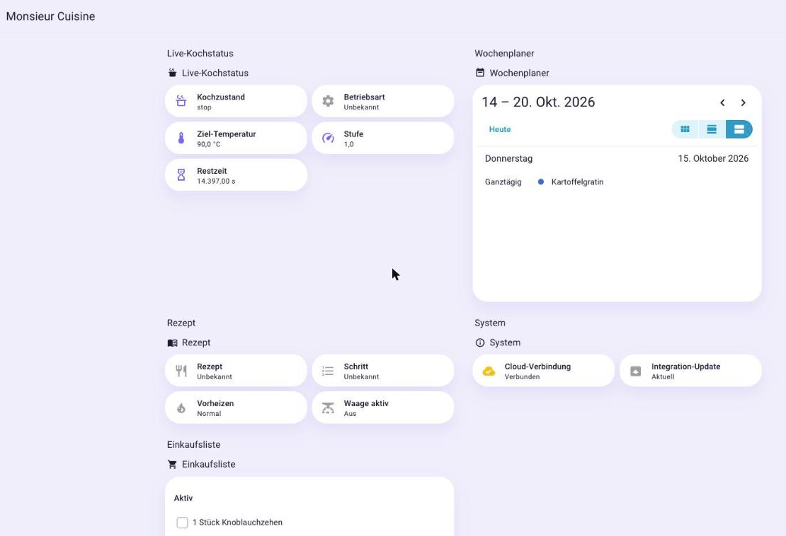
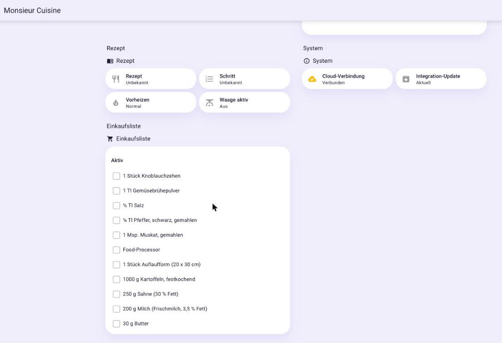

# Monsieur Cuisine for Home Assistant (unofficial)

<p align="center">
  
</p>

<p align="center">
  <a href="https://github.com/MrVain74/ha-monsieur-cuisine/actions/workflows/tests.yml"></a>
  <a href="https://github.com/MrVain74/ha-monsieur-cuisine/actions/workflows/hassfest.yml"></a>
  
  
  
</p>

<p align="center">
  <a href="https://my.home-assistant.io/redirect/hacs_repository/?owner=MrVain74&repository=ha-monsieur-cuisine&category=integration"></a>
</p>

> ⚠️ **Unofficial.** Not affiliated with Lidl, SilverCrest or Tecpal. Uses the undocumented
> cloud interface of the Monsieur Cuisine app. May break at any time if the vendor changes things.
> For your own account only, gentle polling (max. 1 request/second, every 15 minutes).

**Status: Alpha (v0.4.12)** – tested with the *Monsieur Cuisine Smart* (MC3.0).

👉 **Setup guide:** [`docs/SETUP.md`](docs/SETUP.md) · **How it works:** [`docs/HOW-IT-WORKS.md`](docs/HOW-IT-WORKS.md) · Deutsch: [Einrichtung](docs/EINRICHTUNG.md) · [Funktionsweise](docs/FUNKTIONSWEISE.md)

## Screenshots

> _Alpha: an example Home Assistant dashboard. To be replaced with shots from a guided recipe (recipe name, “Step N of M”, rising temperature)._

<p align="center">
  
</p>
<p align="center">
  
</p>

## What it does

| Feature | State |
|---|---|
| **Send recipe** (`monsieur_cuisine.send_recipe`): a recipe page (schema.org/Recipe, e.g. Chefkoch, Mealie) or JSON → your own recipe with **machine steps** | ✅ format verified |
| **Step translator**: “30 sec/speed 5”, “10 min/100 °C/reverse/speed 1”, “weigh 250 g” → device values | ✅ |
| Sensor *Own recipes* | ✅ |
| Diagnostic *Cloud connection* (device currently connected to the cloud) | ✅ |
| Sign-in (Lidl login directly in Home Assistant) | ✅ setup dialog |
| **Live cooking status** (cooking state, mode, target temperature, speed, remaining time, recipe & step, preheating, scale) | ✅ via the cloud (gRPC push), decoded – for the MC Smart |
| **Shopping list** as a to-do list, **weekly planner** as a calendar | ✅ read-only (ticking/adding still to come) |
| Save recipe as “private” (shows up on the device) | ⏳ needs image upload – draft for now, add the picture on the website |

## Entities

Set up on the device *Monsieur Cuisine*:

- **Sensors** (live while cooking): cooking state, mode, target temperature, speed, remaining time, recipe, step. Live values are available on the MC Smart; while the device is off they read *unavailable*.
- **Binary sensors**: preheating, scale active, cloud connection (diagnostic).
- **Sensor** *Own recipes*: number of your own recipes.
- **To-do list** *Shopping list* and **calendar** *Weekly planner* from your account (read-only for now).

> The MC Smart sends a **command echo** over the cloud (setpoints, not measurements), so there is **no actual temperature, lid or error-code** value — confirmed by live testing. Those are only available locally at the device.

## Supported models

Only two Monsieur Cuisine models expose a live status over the cloud and are covered here:

| Model | Name | Live status |
|---|---|---|
| **MC3.0** | MC Smart | ✅ tested |
| **MC0.5** | MC Compact | ✅ format decoded, untested |
| MC2.0 | MC Connect | – not networked |
| MC1.1 | MC Plus | – not networked |

This integration **only reads** status and account data and writes recipes to your own account. It never sends control commands to the device.

## Example

```yaml
action: monsieur_cuisine.send_recipe
data:
  url: https://example.org/recipe/tomato-soup
  dry_run: true   # preview first
```

Response (shortened):

```yaml
title: Tomato soup
steps:
  - title: Chop
    setting: 5 sec / speed 5
  - title: Cook
    setting: 20 min / 100 °C / speed 1 / reverse
  - title: Stir in cream
    setting: null
warnings: []
```

Without `dry_run` the recipe is created as a **draft** in your account (`recipe_id` in the response).
With `recipe_id` an existing recipe of yours is overwritten.

## Translator limitations

- Turbo is not applied yet (kept as text, with a warning).
- “Varoma” is applied as 120 °C – for steaming, pick the “Steam” program instead.
- Half speeds (e.g. 4.5) are rounded up.
- Units the Monsieur Cuisine editor doesn’t know (ml, packet, can …) are appended in brackets to the ingredient name.
- Everything detected is a **suggestion** – check it in the recipe before cooking.

## Installation (HACS, custom repository)

1. HACS → top right ⋮ → **Custom repositories** → this repo, category *Integration*.
2. Install “Monsieur Cuisine (unofficial)”, restart Home Assistant.
3. Settings → Devices & Services → Add integration → *Monsieur Cuisine*.

Lidl only ever hands the one-time code to an address compiled into the vendor
app (`lidl-com…://login/prod`), and a browser cannot pass that on to Home
Assistant – measured in Chrome, the redirect is **discarded silently** and the
address appears nowhere, not even in the address bar. Only something that may
read alongside the page can catch it, so there is **one** sign-in path:

- **The browser helper:** a tiny add-on from
  [`browser-helper/`](browser-helper/) catches the redirect and hands the code to
  Home Assistant. The setup dialog then finishes on its own – not even a click.
  The add-on may only read redirects from `accounts.lidl.com` and nothing else.

Your e-mail, password and the captcha always stay between you and Lidl; the
captcha is never bypassed.

Step-by-step: [`docs/SETUP.md`](docs/SETUP.md) (Deutsch: [`docs/EINRICHTUNG.md`](docs/EINRICHTUNG.md)).

## Development

```bash
python3 -m pytest tests            # translator and payload
python3 tools/mc_cli.py parse "10 min/100 °C/speed 1"
python3 tools/mc_cli.py preview --schema recipe.json
```

The `mcbridge` library has no dependency on Home Assistant.

## Author

Built by **MrVain74** ([@MrVain74](https://github.com/MrVain74)). Unofficial, not affiliated with Lidl, SilverCrest or Tecpal. Thanks to everyone helping to test.

License: MIT
